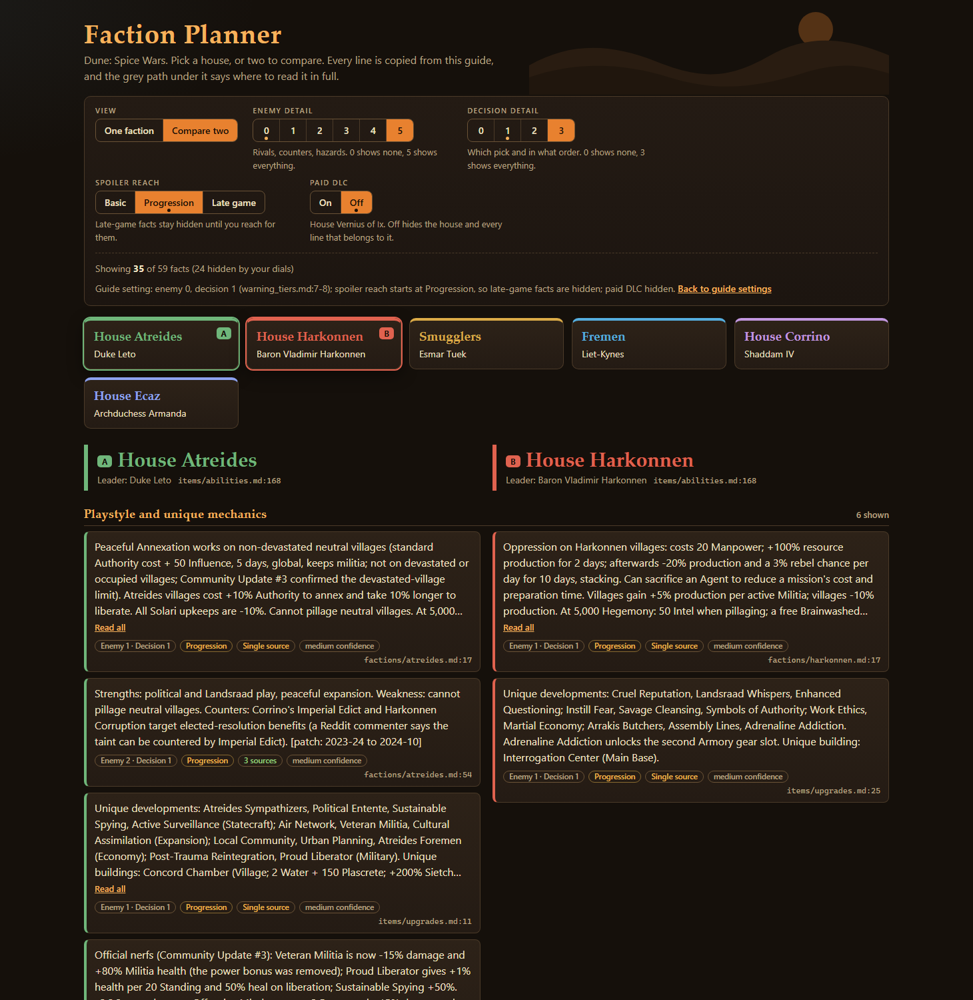

# Dune: Spice Wars

A free hint guide for Dune: Spice Wars, with spoiler levels you control. Get help with the houses, the Landsraad, Conquest and skirmish strategy. Your AI agent answers only from the guide files, and says so when the guide does not know.

## Use it

Install the [reader](https://github.com/hintforge/reader) in any AI agent that can read files on your computer, then tell it:

> Load the Dune: Spice Wars guide from github.com/hintforge/dune-spice-wars

Try "how do I open as Fremen", "what does a Charter need" or "what should I watch for when I play Smugglers".

The guide uses the [Hintforge](https://github.com/hintforge/builder) format. The agent reads and writes only files you control.

## Spoilers

Two independent dials control how much the guide volunteers about enemies (Tier 0 to 5) and about decisions (Tier 0 to 3). Both start quiet. The game has little story, so the dials gate strategy depth, not plot. Raise them for rival counters, build orders and step by step plans.

House Vernius of Ix is paid DLC and has its own switch, which starts off. Turn it on when you own the DLC.

## Faction planner

Open `artifacts/faction_planner.html` in any browser. Pick a house, or two to read side by side, and it lays out how the house plays, its heroes and councillors, its Conquest starting traits, how to open, what the Landsraad and the Governorship mean for it, and which victories it leans toward. The enemy, decision, spoiler and DLC controls start at the guide's settings and hide whatever you have not asked to see. Every line is copied from the guide and carries the path of the file it came from. Nothing leaves your browser.

To rebuild the page after you edit the guide, run `python extract_tools/build_faction_planner.py`.

## What's inside

- Core rules: resources, Hegemony, the Landsraad, council and CHOAM, victory routes.
- The six base houses and House Vernius of Ix, with heroes, councillors, unique developments, gear and builds.
- Conquest, solo skirmish and multiplayer, including the Conquest unlock and progression tables.
- The achievement list, controls and settings.
- A register of the places where sources disagree, kept with every value instead of guessed.

Lines that rest on a single publisher say so. Opening orders come mostly from older forum reports and carry their patch.
